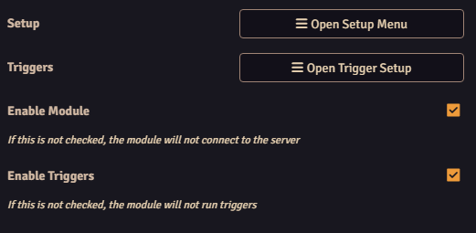
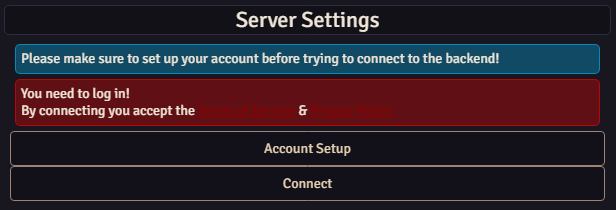
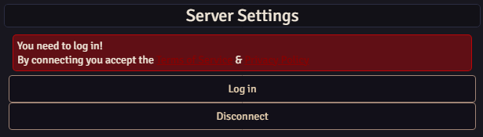
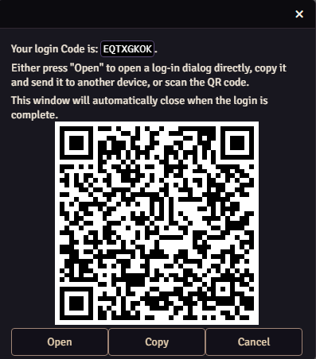
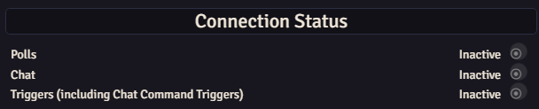

Ethereal Plane connects your Foundry world to your stream account. This setup has two parts: connect the Foundry installation, then log into your account from that installation.

## Install and open Setup

1. Install **Ethereal Plane** through Foundry's module installer. This release supports Foundry **13 through 14**.
2. Launch your world and enable Ethereal Plane in **Manage Modules**.
3. In **Settings → Configure Settings → Ethereal Plane**, click **Open Setup Menu**.

Keep **Enable Module** enabled when you want the connection running. **Enable Triggers** separately controls whether stream events execute your assigned macros.

## Connect this Foundry installation

In Setup, find **Server Settings**.

1. If you don't have an Ethereal Plane account, use **Account Setup** to create one.
2. Click **Connect** in Foundry.
3. Follow the website's request to add this Foundry installation to your account.
4. Return to Foundry. The connection controls should now offer **Log in** and **Disconnect**.

You connect an installation once. Other people logging into their accounts on the same Foundry server don't need to register the installation again.

## Log into your account

1. Click **Log in**.
2. In the login window, click **Open**, use **Copy** to open the address in another browser, or scan the QR code.
3. Check that the code shown on the website matches the code in Foundry's window.
4. Sign into your Ethereal Plane account and confirm the request.
5. The Foundry login window closes automatically when login succeeds.

Use the code from your own login window, not the example screenshot. If it expires, close the window and click Log in again for a new one.

## Check the connection indicators

These indicators describe separate connections:

| Indicator | When to expect it to be active |
| --- | --- |
| **Polls** | While a poll is running. It can be inactive between polls. |
| **Chat** | When a direct chat-reading connection is being used. Sending messages or using chat-command triggers alone doesn't require this indicator to be active. |
| **Triggers** | When trigger processing is connected and enabled. |

An inactive indicator doesn't mean every feature is disconnected. Check the feature you're trying to use.

## Choose a first feature

- [Send public rolls to chat](../rolls-and-troubleshooting/) and customise their message template.
- [Run a poll](../polls/) and optionally attach a macro to its winning choice.
- [Create a chat command or channel-point trigger](../triggers/) and assign a Foundry macro.

If a feature doesn't work, check **Enable Module**, the installation connection and your account login before configuring it again. The feature guides cover their separate settings.
