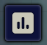
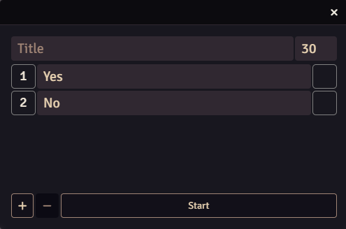
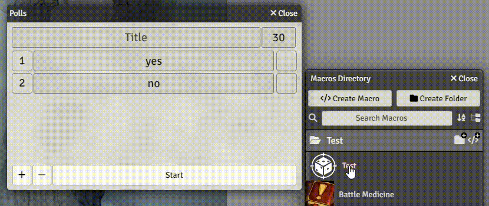
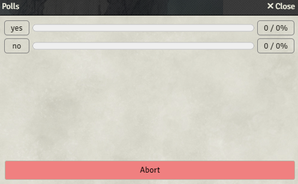

A poll lets viewers choose between options. You can attach a Foundry macro to each option so the winning choice changes something in your game.

## Open and configure a poll

Enable **Polls Enabled** in Ethereal Plane's Setup menu, then click the poll button in Foundry's **Token** scene controls.

1. Enter the question in **Title**.
2. Enter the choices beside their fixed option numbers.
3. Use **+** or **−** to add or remove choices. The editor supports two to five.
4. Set the duration in seconds. For a Twitch poll, use **30–300 seconds**.
5. For a first test, leave the macro slots empty and choose a simple question you can answer from chat.

## Attach macros

Drag a world macro from the Macro directory or hotbar into the small box beside its option.

Left-click an attached macro to edit it; right-click to remove it. Run a macro directly before attaching it so you know what the winning choice will do.

The winner's macro runs on the GM client, without target information. If two options tie, the lower-numbered option wins: a tie between 2 and 5 chooses 2.

## Start and follow the vote

Click **Start**. With Twitch's hosted poll feature, viewers vote in the Twitch poll. In chat-vote modes, they type the option number into chat. Each viewer has one current choice; a later choice replaces their earlier one.

Results update in Foundry while the poll runs. At the end of the duration, the winning option's attached macro runs, if it has one.

## Abort a poll

Click the red **Abort** button to end a running poll without executing a winning macro. This also stops its Twitch poll when one is running.

Use Abort if you started the wrong question or attached the wrong macro. It is different from letting the duration finish.

## If a poll doesn't start

- Check **Polls Enabled** in Setup and complete both installation connection and account login.
- Check the duration is valid for the selected service.
- Check the **Polls** connection while starting or running a poll. Inactive between polls is expected.
- Check the macro directly if voting completes but its result doesn't do what you expected.
