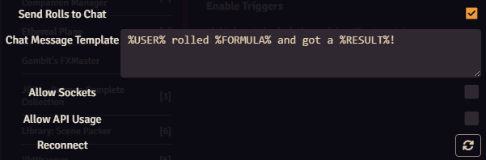
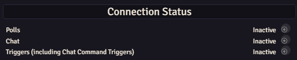

Public rolls can be sent to your stream chat with a message you customise. Private and whispered rolls are excluded.

## Enable roll messages

1. Open **Settings → Configure Settings → Ethereal Plane → Open Setup Menu**.
2. In **General**, enable **Send Rolls to Chat**.
3. Edit **Chat Message Template** if you want a different message.
4. Make a public roll in Foundry and check your connected stream chat.

[](/media/ethereal-plane/public/3.3.0/user/assets/ep-rolls.png "Open full-size screenshot")

The template supports these placeholders:

| Placeholder | Replaced with |
| --- | --- |
| `%USER%` | The player's display name. |
| `%FORMULA%` | The roll formula, such as `1d20+4`. |
| `%RESULT%` | The roll's result. |

For example:

```text
%USER% rolled %FORMULA%: %RESULT%
```

The streamer needs a working chat connection. Check account login and the selected service if a public roll appears in Foundry but no message reaches chat.

## MidiQoL rolls

MidiQoL needs one additional option: enable **Allow Sockets** at the bottom of the General tab. This lets player clients send their evaluated MidiQoL roll information to the GM for broadcast.

That option also permits player clients to submit roll-message text. Enable it for a group you trust to use it appropriately.

## Check the right connection

[](/media/ethereal-plane/public/3.3.0/user/assets/ep-status.png "Open full-size screenshot")

- **Polls** can stay inactive until a poll runs.
- **Chat** indicates a direct chat-reading connection. Sending roll messages and using chat-command triggers do not by themselves make it active.
- **Triggers** is separate from both. Check **Enable Triggers** and the macro assignment if chat commands or rewards don't execute a macro.

Connecting the installation and logging into your account are separate setup steps. If login expires, reopen **Log in** and complete the fresh code request. [Getting started](../getting-started/) shows both steps.
