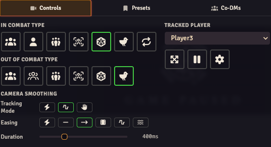

OBS Utils gives your stream its own Foundry view. You keep playing in your normal browser and control what the audience sees from there.

> **Video walkthrough:** [Watch OBS Utils — Basic Setup on YouTube](https://www.youtube.com/watch?v=JbWA9kARx0U). The video shows an older interface; the steps below use this version's menu labels.

## 1. Install and enable the module

Link Patreon in your [Foundry account profile](https://foundryvtt.com/me/), then find **OBS Utils Premium** under **Subscribed Content**. Install it through Foundry's module installer, along with **libWrapper** and **libCamera** (1.13.2 or newer, below 2.0).

Launch your world, open **Manage Modules**, enable those dependencies and **OBS Utils Premium**, then save. Disable the public **OBS Utils** edition in that world; use one edition at a time. Premium 5.4.1 supports Foundry **13.351 through 14**.

Moving from Free? [Import your existing settings](../setup/#import-settings-from-the-other-edition) before continuing. Premium's grouped settings are under **Settings → Configure Settings → OBS Utils Premium → Open Setup**.

## 2. Create a Foundry user for OBS

In your world, open **Game Settings → User Management** and create a user called **OBS** with the **Player** role. Save your changes. This is a Foundry world user, not another Foundry licence or Patreon account.

Keep your GM logged in through your normal browser. The OBS user will log in inside OBS Studio, so your own menus and camera movements can stay separate from the stream.

The OBS user sees only what that user has permission to see. Don't give it the GM role just to get the picture working.

## 3. Choose the address to put in OBS

Open your running Foundry world in your normal browser and look at the address bar. Copy the full address ending in **`/game`**. This is the game address, not your hosting provider's dashboard or Foundry's administration page.

**For your first setup, use `/game`.** It shows the map and tokens. `/stream` is a different view: it shows only overlays, without the game board.

<figure class="setup-url-example">
<figcaption>Keep your Foundry address. Change only the last part.</figcaption>

Game board<code>https://my-game.example/<mark>game</mark></code>

Overlays only<code>https://my-game.example/<mark>stream</mark></code>

</figure>

Replace `my-game.example` with your own Foundry address. Do not paste just `/game` or `/stream` into OBS, and do not add `/stream` after `/game`.

If your address has a port number or extra folder, keep it:

| Working game address | Overlays-only address |
| --- | --- |
| `https://my-game.example/game` | `https://my-game.example/stream` |
| `https://my-game.example/foundry/game` | `https://my-game.example/foundry/stream` |
| `http://localhost:30000/game` | `http://localhost:30000/stream` |

The `localhost:30000` example is for OBS running on the same computer as your Foundry server. Otherwise, use the Foundry address that works from the computer running OBS.

If your invitation link ends in `/join`, replace that final `/join` with `/game` for the game board, or `/stream` for overlays only. Keep the rest of the address.

### Using a hosting provider?

Specialised Foundry hosts such as **Sqyre** may need extra configuration, or a message to their support team, before `/stream` is reachable. If your normal game address works but the matching `/stream` address gives a missing-page error or sends you to the host's dashboard, ask the host how to access Foundry's `/stream` route.

I can't provide hosting-provider-specific setup or support. I can help with OBS Utils itself; your host handles its URLs, access requirements and server configuration.

## 4. Add the browser source in OBS Studio

1. In OBS Studio, select the scene you want to use.
2. In **Sources**, click **+ → Browser**. Name it **Foundry**.
3. Paste your full **`/game` address** into **URL**.
4. Set the width and height to match your OBS canvas, for example **1920 × 1080**, then click **OK**.
5. Right-click the new source and choose **Interact**. This opens a window where you can click the Foundry login screen.
6. Log in as the **OBS** user you created, then close the interaction window. Keep the browser source visible.

**You should now see your Foundry game in the OBS preview.** A normal OBS Browser source is detected automatically; leave the manual OBS-mode settings alone for now.

## 5. Frame the game with the Director

Return to your GM browser and activate the scene you want to show. In the token scene controls, click the broadcasting-signal button, **Open Stream Director**.

In **Controls**, choose **Fit Map to Screen** for **Out of Combat Type**. Hover a mode button to read its name. If combat is active, set **In Combat Type** too.

The image shows the 2D camera controls. Colours and spacing may differ with your Foundry theme.

**Check the OBS preview:** the map should fit the source. To follow your GM camera instead, choose **Clone the DM's Viewport**. [Camera modes](../camera-modes/) explains the other choices.

## 6. Add overlays when the game view works

Open **Settings → Configure Settings → OBS Utils Premium → Overlay Editor → Open Editor** in your GM browser. Follow the [Stream Composer guide](../stream-composer/) to create an overlay and choose its actor data.

You can keep using `/game`. Use `/stream` when you want an overlays-only browser source, for example over a game view captured another way. To switch, open the browser source's properties and replace the final `/game` with `/stream` using the examples above.

**A blank or transparent `/stream` view is normal before you have an overlay to display.** It never shows the map. If you want the game board, switch back to `/game`.

## Optional: let Foundry control OBS

You do not need a WebSocket connection just to display Foundry or its overlays. Set up [OBS Remote](../obs-remote/) when you want Foundry events to control OBS scenes or sources. That guide starts with the usual same-computer setup: **leave the host as `localhost` or `127.0.0.1`**.

## If you're stuck

| What you see | What to check |
| --- | --- |
| The hosting dashboard or an error page | Copy the actual running world's address. Keep its host, port and any folder before `/game`; for `/stream` access on a hosted service, check with the host. |
| Foundry's login screen inside OBS | Right-click the browser source → **Interact**, then log in as **OBS**. |
| A transparent source with no map | Check whether its URL ends in `/stream`. Use `/game` to show the map. |
| The map appears, but the camera follows the wrong thing | Change the Director mode for the current combat state and check the OBS user's scene. |
| Your GM browser has hidden menus | You may have enabled **Pin This Browser to OBS Mode** in your normal browser. Use [the recovery steps](../manual-mode/). |

For help with OBS Utils, join [Discord](https://discord.com/invite/WfMaKPPdeM). Include your module version, Foundry version, whether you used `/game` or `/stream`, and what appears in OBS. Don't post passwords or private invitation links.
