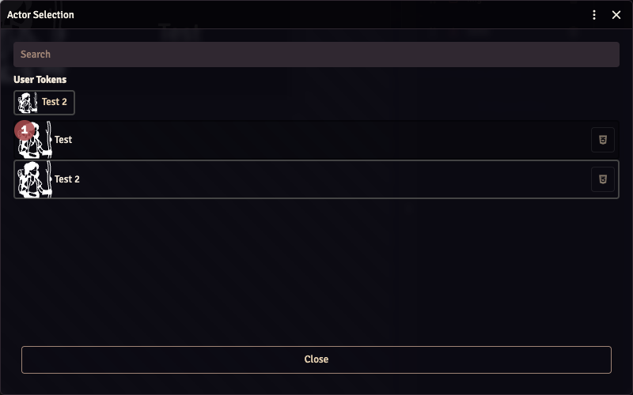

The Overlay Editor builds the graphics shown over your stream: a character portrait, a name, a health bar, or a whole panel containing several of those. Each piece is a **component**.

This walkthrough creates a **Canvas** overlay with a portrait and an actor's name. Canvas is the WYSIWYG layout: you position and resize components directly in the preview. **Inline** is the alternative that arranges components in a row.

Complete [Getting started](../getting-started/) first so you can check the result in OBS.

## 1. Create a Canvas overlay

In your GM browser, open **Settings → Configure Settings → OBS Utils Premium → Overlay Editor → Open Editor**.

Click **+** at the top of the **Overlays** panel and choose **Custom canvas**. If the editor opens on its template screen, choose Custom canvas there.

An overlay is the container for your components. **Custom canvas** creates an empty one; a starter template creates one with components already inside it. Both can be edited afterwards.

## 2. Set the panel's dimensions

Click the **settings cog** beside the overlay's name at the top of the workspace.

- Give it a name, such as `Hero panel`.
- Keep **Type** set to **Canvas**.
- Set **Tile by** to **Actors**.
- Set **Canvas width** to `420` and **Canvas height** to `160`.

These dimensions are the size of this panel, in pixels. They don't change your OBS browser source's size. Use your stream resolution, such as 1920 × 1080, when you want to design an overlay covering that whole area.

**Actors** creates a copy of the panel for each actor you select. **Once (singleton)** creates one copy instead; use that for an overlay that shouldn't repeat for the party.

Click **Layout** to return to the visual editor.

## 3. Choose an actor

Click **Manage Actors** at the bottom left, find an actor and select its row. Close the actor selector.

In **Preview as**, above the canvas, choose that actor. The example screenshots use an actor named Test; choose a character from your own world.

These controls do different jobs:

- **Manage Actors** chooses the actors whose overlays appear on stream.
- **Preview as** chooses which of those actors you see while editing. It doesn't change the stream's actor selection.

Start with one actor so you can see the panel you're arranging. Add the rest of the party after the first panel works.

## 4. Add a portrait

Click **Add Component** and choose **Image**. Select the new component on the canvas or in the component list to open its properties on the right.

Under **Data**, enable **Data-driven**. Open the picker, search for `img`, and choose the actor field `img` from the Actor results. The actor's portrait should appear on the canvas.

**Data-driven** means the image comes from the current actor. Leave it off to choose a fixed image file, such as a decorative frame, that should be the same for everyone.

Drag the portrait into the left side of the panel. Drag a corner handle to resize it. For the example, the portrait occupies a 128 × 128 box with a 16-pixel margin on the left and top.

### Read the position controls

The inspector also lets you enter a precise layout. Select the component you want to edit first.

| Control | Meaning |
| --- | --- |
| **X** | Distance from the panel's left edge, in pixels. |
| **Y** | Distance from the panel's top edge, in pixels. |
| **W** | Width of the component's box. |
| **H** | Height of the component's box. |
| **Rotation** | Rotation in degrees. |
| **Locked** | Prevents moving or resizing the component on the canvas. |

The portrait's example values are **X 16, Y 16, W 128, H 128**. A component's box controls its placement; font size and other appearance choices are in **Style**.

## 5. Add the actor's name

Click **Add Component → Text**, then select the new Text component.

Enable **Data-driven**, open its picker and choose the actor field `name`. The component should now display the selected actor's name. With Data-driven off, a Text component displays fixed text you type yourself instead.

Drag the name to the right of the portrait and resize its box. In this example it uses **X 160, Y 56, W 240, H 40**.

The workspace has three useful areas beside the overlay list:

- **Canvas:** click a component, drag it to move it, or use its handles to resize it.
- **Components:** select a component here when it is small, covered by another component, or difficult to click on the canvas.
- **Inspector:** change the selected component's type, position, size and data.

The component list may show `img` or `name` after you bind those fields. Those are the data paths you've chosen.

## 6. Style the name

With the Text component selected, click **Style** at the bottom of the inspector. In the drawer, choose **Component → Simple**.

Set **Font size** to `32px` and choose a text colour that is readable over your game. The example keeps the Text component's default centring.

**Component** styles the selected piece. **Overlay** styles the containing panel. Use the drawer's **Done** button when you've finished.

**Advanced** edits CSS directly. You don't need it for this example; [Custom CSS](../custom-css/) covers the additional styling options.

## 7. Check the result on stream

The editor saves changes as you work; dragging and resizing are saved when you release the mouse. Finish editing a field before closing the window.

Open **Preview** to see all enabled overlays together, then check your actual OBS browser source. The portrait and name should appear there for the actor selected in Manage Actors.

The panel's background is transparent on stream unless you give it a background. The editor's dark canvas is there to help you arrange the components.

Add another actor through **Manage Actors** when you're ready. An overlay tiled by Actors repeats with each actor's portrait and name; you don't need to build a separate panel for every party member.

## Add health or other values

Use **Add Component → Progress Bar** for a resource with a current and maximum value. Its **Value path** is the current resource; **Max path** is its maximum. Choose the matching fields in the data pickers.

For the D&D 5e actor used here, HP is `system.attributes.hp.value` and maximum HP is `system.attributes.hp.max`. Other systems can store health elsewhere. A system companion adds readable field names to help you choose the right ones.

| Component | What it adds |
| --- | --- |
| **Text** | Fixed text or an actor value. |
| **Image** | Fixed artwork or a data-driven image. |
| **Icon** | A Font Awesome icon. |
| **Conditional Icon / Image** | Different artwork depending on a value. |
| **Icon Counter / Image Counter** | A repeated symbol for a numeric value. |
| **Progress Bar** | A resource with current and maximum values. |

## Arrange overlapping components

Drag rows in the component list to change their drawing order. The top row is drawn first; later rows appear over it. Put a background before the text or portrait it should sit behind.

Use the arrow keys to nudge a selected Canvas component by one pixel, or **Shift + Arrow** for ten pixels. With the canvas focused, **Escape** deselects it. The trash button removes a component; the overlay list has its own separate delete button for the whole overlay.

## If something is missing

- **A field name appears as text:** enable Data-driven and select the actor field in the picker.
- **No portrait or name appears:** choose an actor in Manage Actors, select it in Preview as, and check the data path.
- **A component won't move:** check Locked, or select it from the component list if another component covers it.
- **The panel repeats more times than intended:** review Tile by and the selected actors.
- **It works in the editor but not OBS:** check the stream user's actor permissions and that the overlay's eye button is enabled.

Use [Overlay animations](../overlay-animations/) when you want the panel to react to rolls or other events. [Bundles](../bundles/) explains saving an export or sharing the layout with another world.
