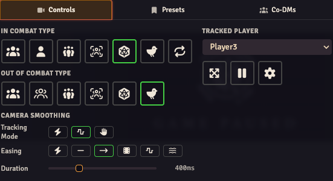

Open the **Stream Director** from the broadcasting-signal button in the Token scene controls. In **Controls**, choose how the stream camera should behave during and outside combat.

## Choose a mode

Hover a mode button to read its name. **In Combat Type** applies while combat is running; **Out of Combat Type** applies otherwise. Setting one doesn't change the other.

| Mode | What the stream follows |
| --- | --- |
| **Track all Owned Tokens** | Tokens owned by the user logged into the stream browser. |
| **Track the currently active Owned Token** | The current combatant, when owned by the stream user. |
| **Track Player-Owned Tokens** | Player-owned tokens on the scene. |
| **Track a manual List of Tokens** | The tokens you explicitly choose for manual tracking. |
| **Clone the Selected Player's Viewport** | The user selected in **Tracked Player**. |
| **Clone the DM's Viewport** | The active GM's view. |
| **Clone the Turn Player's Viewport** | The player whose turn it is in combat. |
| **Fit Map to Screen** | The whole map, fitted to the stream view. |

Some modes are specific to the in-combat or out-of-combat row. Choose from the buttons available in that row.

## Show the whole map

1. Activate the scene you want to show.
2. Choose **Fit Map to Screen** in the applicable combat row.
3. Look at the OBS preview. The map should fit the source.
4. Start or end combat and check the other row if the view changes unexpectedly.

## Follow a player or GM

For a player's view, select **Clone the Selected Player's Viewport**, then choose their user under **Tracked Player**. Pan that user's view and check the OBS preview.

For the GM's view, choose **Clone the DM's Viewport**. With several GMs online, the **Co-DMs** tab selects whose view is active; see [Multi-GM handover](../multi-gm/).

These modes copy a view rather than granting the stream user additional actor permissions. Keep the stream user separate from your GM login.

## Follow tokens

Choose a token-tracking mode when you want framing to follow the party instead of someone else's browser. Make sure the stream user's token ownership matches the intended mode.

For manual tracking, use **Track a manual List of Tokens** outside combat. The module's **Toggle Token Tracking** keybinding adds or removes the hovered or controlled tokens. Find or assign the binding in Foundry's **Configure Controls**.

## Smooth or pause movement

The camera-smoothing controls choose how camera movement reaches its destination. Set an easing curve and a duration; a longer duration makes the pan take longer. **Direct** applies a move without an eased transition.

The tracking update modes have separate purposes:

| Mode | Use it when |
| --- | --- |
| **Raw** | Every source-view update should reach the stream immediately. |
| **Smooth** | You want to smooth small changes while following a user. |
| **Drag release** | The audience should see the new view after you finish dragging. |

**Pause Camera Tracking** stops tracking temporarily. **Limit Canvas to Screen Edges** constrains framing to the map. Check both when a view appears stuck or is being cropped.

For a view you want to recall later, use [camera presets](../scene-presets/).

## Keyboard shortcuts

Change these in Foundry's **Configure Controls** if they conflict with your other bindings.

| Mode | In combat | Outside combat |
| --- | --- | --- |
| Track all Owned Tokens | Ctrl + Shift + 1 | Shift + 1 |
| Track current Owned Token / manual list | Ctrl + Shift + 2 | Shift + 2 |
| Track Player-Owned Tokens | Ctrl + Shift + 3 | Shift + 3 |
| Clone selected player's view | Ctrl + Shift + 4 | Shift + 4 |
| Clone DM's view | Ctrl + Shift + 5 | Shift + 5 |
| Fit Map to Screen | Ctrl + Shift + 6 | Shift + 6 |
| Clone turn player's view | Ctrl + Shift + 7 | — |
