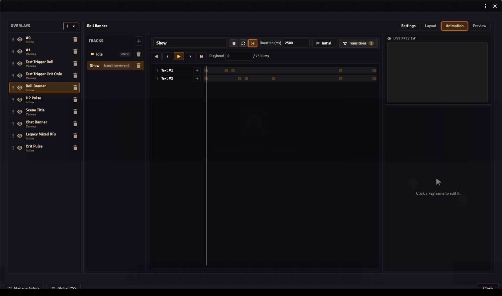
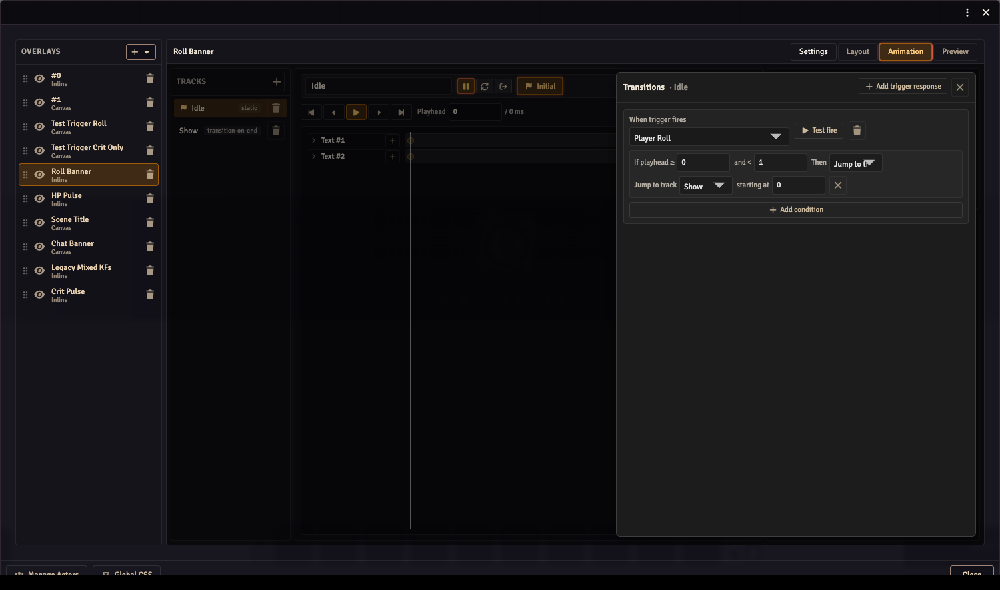

Animations control how an overlay's components move, fade and react to events. A **track** describes one part of that behaviour. A **trigger response** chooses another track when an event occurs.

This example makes a name plate stay hidden until a public roll, appear briefly, then return to its hidden state. Use an overlay with a Text component from the [Stream Composer guide](../stream-composer/).

## Open Animation

Select the overlay and open **Animation**. If it has no animation yet, click **Set up animation**.

The left panel lists the tracks. The middle contains the selected track's name, behaviour, duration and timeline. The right side shows its live preview and the properties of the selected component or keyframe.

## 1. Make a hidden starting track

1. Select the initial track in the left panel. Its flag marks it as the track used when the overlay opens.
2. Give it the name `Idle` in the name field above the timeline.
3. Choose **Static (no playback)** with the behaviour buttons. Hover an icon to see its label.
4. Select your Text component in the timeline.
5. At playhead `0`, set **Opacity** to `0` and finish editing the field. Changing the value creates a keyframe at that time; its diamond becomes filled.

This track holds the component transparent. It isn't the overlay list's visibility toggle: keep the overlay itself enabled so it can receive triggers.

## 2. Make a visible track

1. Click **+** beside **Tracks** to add another track. Select it and name it `Show`.
2. Choose **Transition to another track on end** with the behaviour buttons.
3. Set **Duration (ms)** to `2000`, which is two seconds.
4. Click **Transitions**. Under **When track ends**, set **Jump to track** to Idle and **starting at** to `0`, then close the drawer.
5. At playhead `0`, select the same component, set **Opacity** to `100` and finish editing the field to create its keyframe.

Show now holds the name visible for two seconds, then returns to Idle. Every component you want to hide needs its own opacity keyframe; hiding one Text component does not hide the overlay's other images or bars.

## 3. Connect a roll to Show

Select Idle, then click **Transitions** above the timeline.

1. Click **Add trigger response**.
2. Under **When trigger fires**, choose **Player Roll**.
3. In the condition row, set **If playhead ≥** to `0` and **and <** to `1`. Idle is static at time zero.
4. Choose **Jump to track**, select Show, and leave **starting at** set to `0`.
5. Click **Test fire**. The name should appear, remain visible for two seconds, then disappear.

Test a real public roll while watching the OBS browser source too. Private and blind rolls aren't public stream events.

## Add a fade

On Show, use opacity keyframes instead of keeping one value for the whole track:

| Time | Opacity | Result |
| --- | --- | --- |
| `0` | `0` | Start hidden. |
| `200` | `100` | Fade in over 0.2 seconds. |
| `1800` | `100` | Hold until the last 0.2 seconds. |
| `2000` | `0` | Fade out before returning to Idle. |

Move the playhead to each time, change the property value and finish editing the field to save its keyframe. If the value is unchanged, click the empty diamond to add a keyframe with that value. Clicking a filled diamond removes the existing keyframe. Click an existing keyframe to edit its time, value and easing. **Linear** gives an even fade; other easing options change the speed through it.

The **X** and **Y** properties control the component's position. **Rotation** turns it. Animate the properties you need; the layout itself remains the starting arrangement.

## Decide what a second trigger should do

Responses belong to their selected track. A response on Idle does not automatically run while Show is playing.

To restart the effect on another roll, select Show and add a Player Roll response that jumps to Show at time `0`. Set its time condition to cover the full Show duration. To keep the first effect playing uninterrupted, leave Show without that response, or use **Do nothing** for the applicable time range.

Several time conditions let one event behave differently during different parts of an animation. The start time is included; the end time isn't. For example, `0` to `500` covers the first half second.

## Use the event's values

A Text component can read values from the event using paths such as `trigger.total`, `trigger.formula` or `trigger.actor.name`. Until an event supplies those values, the component can be empty.

Use the [Triggers guide](../triggers/) for the available built-in events, payload fields and system-companion events. The overlay's **Tile by** setting controls whether the effect belongs to an actor, a player or one shared overlay; choose it in **Settings**.

## Timeline controls and shortcuts

| Control | Action |
| --- | --- |
| Play / Stop | Play or stop the selected track in the editor. |
| Click timeline background | Move the playhead. |
| Click a keyframe | Select it for editing. |
| Drag a keyframe | Change its time. |
| Ctrl/Cmd + drag background | Select several keyframes with a rectangle. |
| Drag selected keyframes | Move them together. |
| Previous / next keyframe | Jump to the neighbouring keyframe. |
| Ctrl/Cmd + previous / next | Jump to the first or last keyframe. |
| Left / Right arrow | Nudge selected keyframes by 1ms. |
| Ctrl/Cmd + Left / Right | Nudge by 10ms. |
| Shift + Left / Right | Nudge by 100ms. |
| Backspace / Delete | Delete selected keyframes. |

## If the effect doesn't work

- **Visible all the time:** check that Idle is the initial track and has an opacity-zero keyframe for each visible component.
- **Appears but never hides:** check Show's duration and its end destination back to Idle.
- **The next roll does nothing:** check which track is playing and whether that track has a response for the event.
- **No value appears:** test an event that supplies the chosen data path, and check its actor or user context.
- **Preview works but OBS doesn't:** check the stream user's actor access, the selected actors and the browser source's connection to the world.
