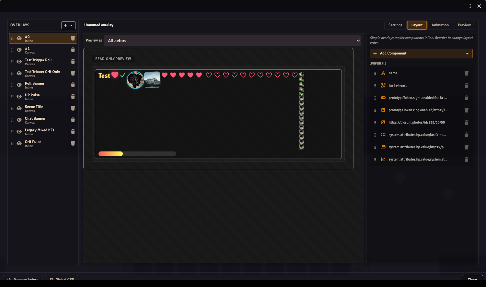
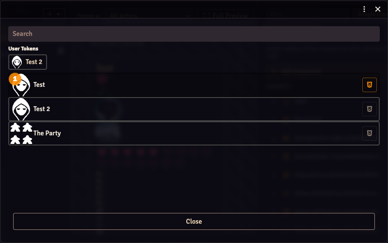
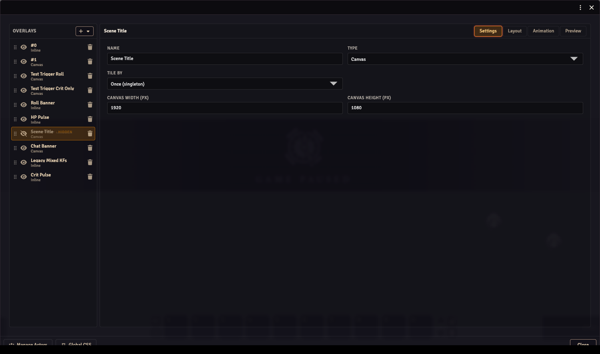
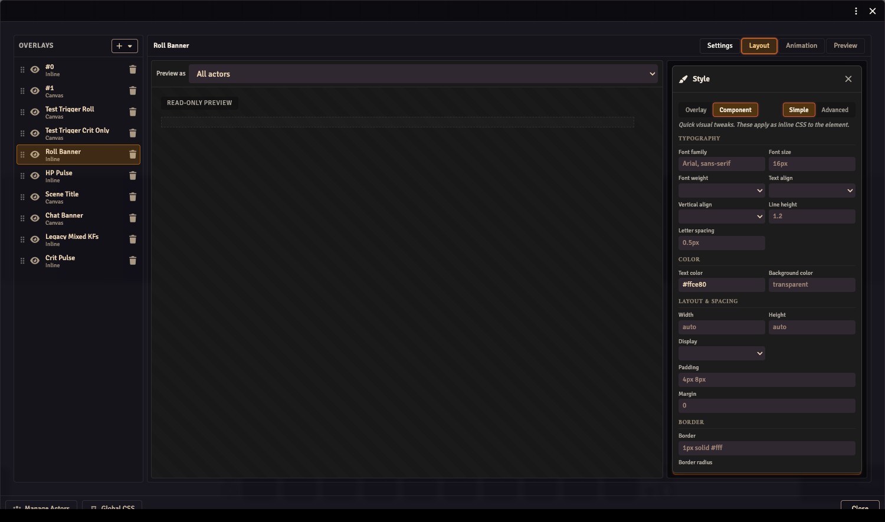
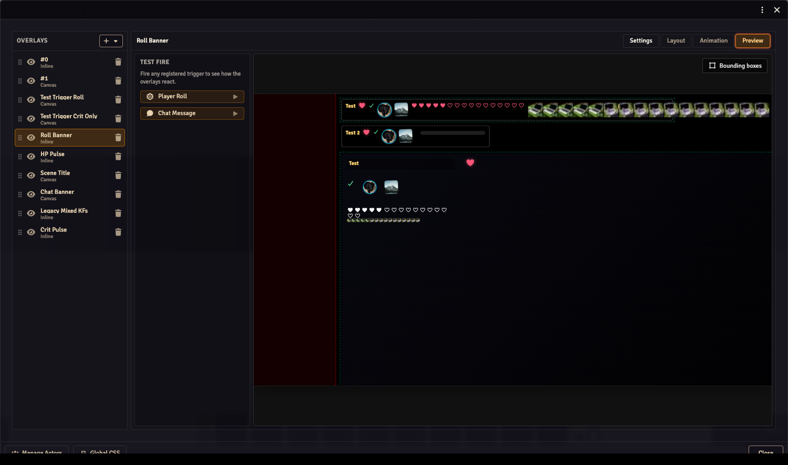

The Overlay Editor is where you build the overlays shown on your stream. An overlay contains components such as text, images, icons and health bars. You can arrange them in a row with **Inline**, or position them freely with **Canvas**.

## Open the editor

In your GM browser, open **Settings → Configure Settings → OBS Utils → Overlay Editor → Open Editor**.

The left panel lists your overlays. Choose one to edit it. The four tabs across the top are **Settings**, **Layout**, **Animation** and **Preview**.

## Make a name plate

This example displays one actor's name. Complete [Getting started](../getting-started/) first so you can check it in your OBS browser source.

1. Click **+** at the top of the overlay list. Choose a blank **Inline** overlay. If the editor opens with template cards instead, choose **Custom Inline**.
2. Open **Settings** and give the overlay a recognisable name, such as `Party names`. Keep **Tile by** set to **Actors**.
3. Click **Manage Actors** at the bottom left. Select an actor you want to display, then close the actor selector.
4. Open **Layout**, click **Add Component**, and choose **Text**.
5. Enable **Data-driven** in the component's editor, then choose the actor's **Name** in the picker, or enter the path `name`.
6. Choose that actor in **Preview as** above the layout. Its name should appear.
7. Check the OBS browser source. The same name should appear there; the stream user needs permission to view that actor.

Use the search field to find actors. The **User Tokens** shortcuts provide quick access to assigned characters. Selecting more actors creates more copies of an overlay tiled by Actors.

## Add a portrait or another value

With the overlay selected, use **Add Component** again:

| Component | Use it for |
| --- | --- |
| **Text** | An actor's name, a readable value or fixed text. |
| **Image** | A portrait or other artwork. |
| **Icon** | A Font Awesome icon. |
| **Conditional Icon / Conditional Image** | Different artwork depending on a value. |
| **Icon Counter / Image Counter** | Repeated icons or images representing a value. |
| **Progress Bar** | A resource with a current and maximum value, such as health. |

For an actor portrait, add **Image**, enable **Data-driven** and choose the portrait field `img`. Leave Data-driven off when you want fixed text or a fixed image instead of actor data. For system values such as HP, use the actor-value picker. D&D 5e, Pathfinder 2e and Call of Cthulhu companions add named groups of fields for their systems. You can also enter a raw data path when a field isn't listed.

A value that isn't present on the selected actor stays empty. Check the actor and the chosen field before treating an empty readout as zero.

## Choose the layout and number of copies

Open **Settings** to change the overlay's name, type and tiling.

| Setting | What it changes |
| --- | --- |
| **Inline** | Components flow in a row. Reorder the component list to change their order. |
| **Canvas** | Components have their own positions and sizes on a reference canvas. |
| **Tile by: Actors** | One copy for each selected actor. |
| **Tile by: Players** | One copy for each active non-GM user. Useful for per-player roll banners. |
| **Tile by: Users (incl. GM)** | One copy for each active user, including GMs. |
| **Tile by: Once (singleton)** | One copy, for an overlay that should appear only once. |
| **Canvas width / height** | The reference dimensions used when positioning Canvas components. |

Changing the overlay type can discard layout information; read the confirmation before switching an existing overlay.

### Arrange a Canvas overlay

Choose **Canvas**, then open **Layout**. Click a component to select it, drag it to move it, and drag its handles to resize it. Arrow keys nudge it by one pixel; **Shift + Arrow** moves it by ten. **Escape** deselects; **Tab** cycles through components.

The component list also controls drawing order. Earlier components draw underneath later ones. Drag its rows to reorder them.

Inline layouts have a read-only layout preview. Use the component list and styling controls to arrange those instead of dragging the preview.

## Style the overlay

Select a component and click **Style** in the properties panel. **Simple** exposes font, colour, spacing, border and image controls. Use the **Overlay** tab in the drawer when you want to style the whole overlay rather than one component.

**Advanced** edits the CSS directly. Switching to Simple preserves declarations it can't represent. For actor-wide and global styles, see [Custom CSS](../custom-css/).

## Manage the overlay list

Drag an overlay's handle to change its order. The eye button enables or hides it; a hidden overlay has a struck-through name and a **HIDDEN** marker. The trash button deletes the overlay.

When there are no overlays, the editor offers template cards such as **HP Bar**, **Name Plate** and **Status Icons**. A template creates an editable overlay. System companions can also supply starter overlays; use **Import starter overlays** to bring those into your world.

## Preview before using it live

Open **Preview** to see the overlays together. Its test-fire buttons let you try registered events, such as a player roll, without waiting for that event in the game.

Use [Overlay animations](../overlay-animations/) to make components fade, move or react to those events. Check the actual OBS browser source after editing: it uses the stream user's actor access and scene, which may differ from your GM view.

## Export or share your work

Use **Export** in the editor's window controls. A JSON export contains the overlay configuration; a **Bundle** also packages referenced images. [Bundles](../bundles/) explains export, append and replace.
