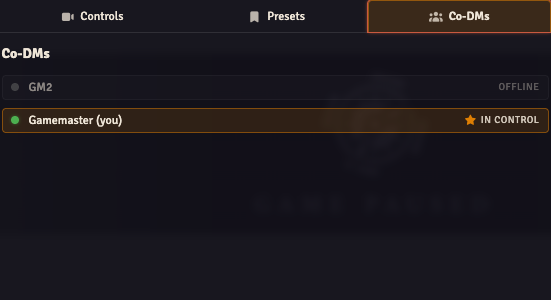

When several GMs are online, **Clone the DM's Viewport** follows one active GM. Use the Director's **Co-DMs** tab to hand that role over.

## Hand over the stream camera

1. Both GMs log into the world with their own GM users.
2. The incoming GM opens **Stream Director → Co-DMs**.
3. On their own row, they click **Take Active**.
4. Their view moves to the previous active GM's view so the handover starts from the same place.
5. Their subsequent camera movements drive the stream while **Clone the DM's Viewport** is selected.

The active online GM has an **In Control** marker. Offline GMs are greyed out. The Take Active button is available for your own online row.

If no active GM is selected, or the selected GM is offline, OBS Utils falls back to the first online GM in the world's user list. The tab only needs a handover when more than one GM user exists.

Switching the active GM does not replace your camera-mode choices. If the stream is following tokens, a player or a preset, check [camera controls](../camera-modes/) before expecting GM movement to appear.
