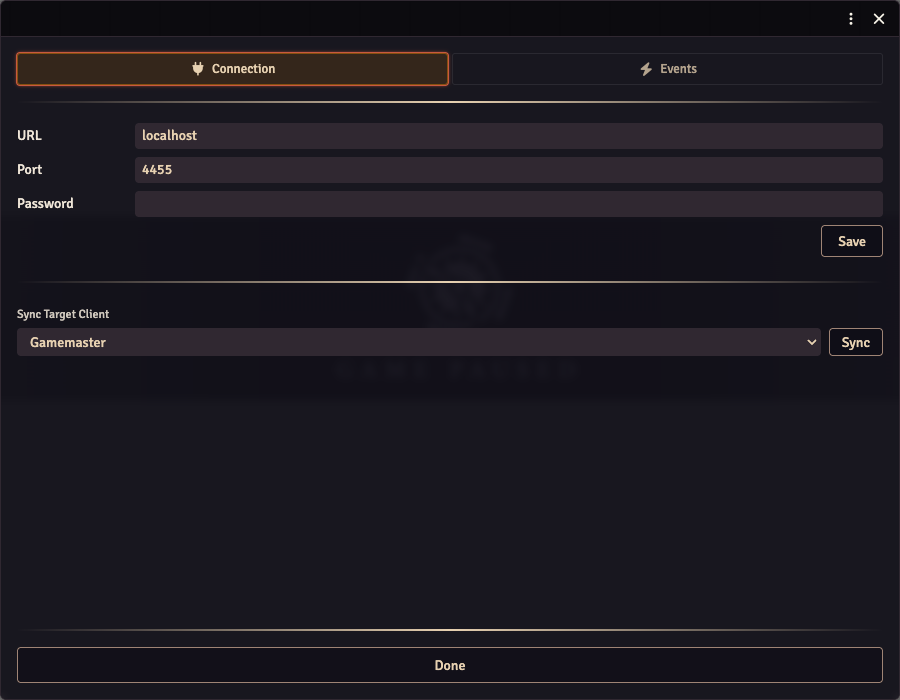

OBS Remote lets Foundry events control OBS. For example, combat starting can switch to your encounter scene, or an event can show or hide a source.

> **Video walkthrough:** [Watch OBS Utils — OBS Remote Control on YouTube](https://www.youtube.com/watch?v=wnCPbJ1eHRs).

To put your Foundry game into OBS, start with [Getting started](../getting-started/). You don't need WebSocket settings just to display the game or overlays.

## 1. Enable OBS's WebSocket server

In **OBS Studio**, open **Tools → WebSocket Server Settings**, enable the server, and keep authentication enabled. Use the connection information there for the port and password. WebSocket support is built into OBS Studio 28 and later; you don't need a separate plugin for those versions. [OBS's remote-control guide](https://obsproject.com/kb/remote-control-guide) covers its server settings.

## 2. Enter the connection in Foundry

Open **Settings → Configure Settings → OBS Utils → OBS Remote Settings → Open Menu**, then choose **Connection**.

**Leave the URL as `localhost` or `127.0.0.1` unless the connection doesn't work.** This is the usual setup when OBS and its Foundry browser source run on the same computer, even if Foundry itself is hosted elsewhere.

| Field | What to enter |
| --- | --- |
| **URL** | `localhost` or `127.0.0.1`. This is the computer running OBS, not your Foundry game URL. Do not add `https://`, `ws://`, `/game` or `/stream`. |
| **Port** | `4455`, unless you changed it in OBS's WebSocket server settings. |
| **Password** | The WebSocket password from OBS. This is not your Foundry login password. |

This screenshot shows the public 5.3.1 Connection tab.

In **Settings → Configure Settings → OBS Utils**, turn on **Enable OBS Websocket?** and save. The toggle is outside the OBS Remote window in this version.

Click **Save** after entering the connection details. If you entered them in your GM browser, select your online stream user under **Sync Target Client**, then click **Sync**. Select the user logged into the OBS browser source, not your GM account.

If your stream user isn't listed, use **Interact** on the browser source to log that user in, then reopen the Connection tab.

## 3. Try one action

1. In OBS Studio, choose a scene with a source you can safely show or hide. Note the exact scene and source names.
2. In Foundry's **OBS Remote Settings → Events**, add a **Pause** event.
3. Add a **Toggle Source** action and enter those OBS scene and source names.
4. Make that OBS scene visible in the preview. In your GM browser, unpause the Foundry game if needed, then pause it.

**The source should change visibility in OBS.** This checks an action that needs WebSocket access. Simple scene switching can also use OBS's browser-source API, so a scene switch alone doesn't confirm the WebSocket connection.

Remove the test event when you're finished. You can then add the events and actions you want for your stream. Actions run in the order you put them in the event.

## If it doesn't connect

- Check OBS is running and its WebSocket server is enabled.
- If `localhost` fails, try `127.0.0.1` before looking for another IP address.
- Recheck the port and WebSocket password, then **Save** and **Sync** again. Refresh the OBS browser source after changing connection details.
- Check **Enable OBS Websocket?** is enabled and the source is logged in as your stream user.
- Check scene and source names match OBS exactly.

Only change `localhost` if OBS actually runs on a different computer from the client making the connection. In that case, enter the address of the **OBS computer**, not the Foundry hosting provider. Firewall or network configuration may also need attention; keep authentication enabled rather than removing the password to try to fix it.

## Configure the events you want

Open **OBS Remote Settings → Events**. Choose an event, then add the actions it should run. Actions execute in their listed order.

| Event | When it runs |
| --- | --- |
| **Load** | Foundry loads on the stream client. |
| **Combat Start** | Combat reaches its first turn. |
| **Combat End** | Combat is deleted. |
| **Pause / Unpause** | The game is paused or unpaused. |
| **Scene Load** | A scene is viewed; use the scene-name condition to target a particular scene. |
| **Stop Streaming** | The OBS WebSocket connection reports that streaming stopped. |

System companions add their events to the same list.

| Action | Fields you need |
| --- | --- |
| **Switch Scene** | The exact OBS scene name. |
| **Toggle Source** | The exact scene and source names. |
| **Enable Source** | The exact scene and source names. |
| **Disable Source** | The exact scene and source names. |

Source controls require the WebSocket connection configured above. Scene switching can use OBS's browser-source support. If an event offers conditions, create an instance for each case you want, then give that instance its own actions.
