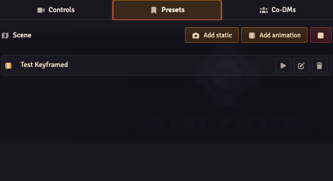
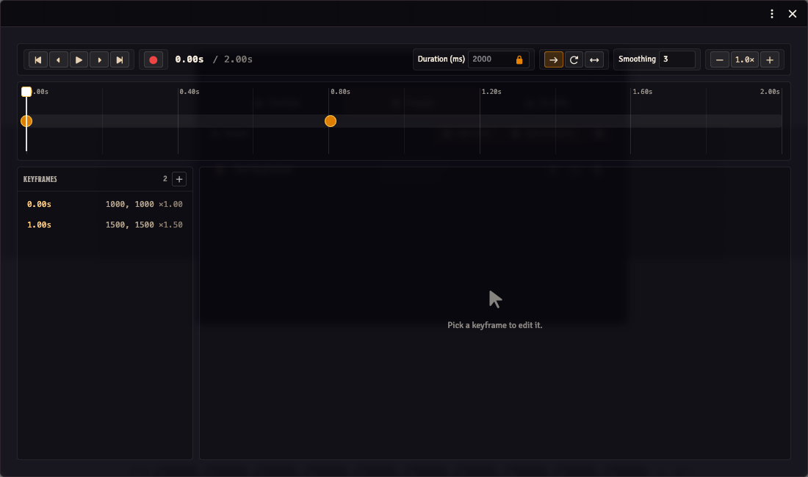

Camera presets save views for the current scene. A static preset recalls one view; an animation moves through several views over time.

## Save and recall a view

1. Open the scene and frame the view in your GM browser.
2. Open the **Stream Director → Presets**.
3. Click **Add static** and give the new preset a name.
4. Move away from that view, then click the preset's **Apply** arrow to recall it.
5. Check the OBS browser source to see the result.

To replace a saved static view, frame the new view and click its **Update** button. Edit its name in the row to rename it. The trash button deletes the preset.

The preset list belongs to the current scene. Switching scenes changes the list; it does not delete the presets on the scene you left.

## Create a camera animation

1. In **Presets**, click **Add animation**. This opens the camera keyframe editor.
2. Frame the starting view, select the first keyframe and use **Capture from current viewport**.
3. Move the playhead to a later time, pan or zoom to the next view, then use **Add keyframe at playhead**.
4. Select each keyframe to adjust its time, position, zoom and easing.
5. Preview the movement locally, then use the preset row's play button when you want it on the stream.

An animation row has an **Edit** button rather than the static preset's Update button. Use it to reopen the editor.

## Timing and playback

Keyframe times and duration are in milliseconds: `1000` is one second. Easing controls how the camera moves into a keyframe. Use a longer interval for a slower pan.

| Loop mode | Result |
| --- | --- |
| **None** | Play once and stop at the final view. |
| **Restart** | Return to the beginning and repeat. |
| **Ping-pong** | Play forwards, then backwards. |

The editor's preview moves your own camera. Playing a preset from the Director sends it to the stream clients. Use the red **Stop** button in Presets to stop the running preset.

## Keyframe shortcuts

| Input | Action |
| --- | --- |
| Click a timeline marker | Select the keyframe. |
| Drag a marker | Change its time. |
| Ctrl/Cmd + drag timeline | Select keyframes in a time range. |
| Ctrl/Cmd + mouse wheel | Zoom the timeline. |
| Ctrl/Cmd + click Play | Play from the start. |
| Ctrl/Cmd + previous / next keyframe | Jump to the first or last keyframe. |
| Left / Right arrow | Nudge selected keyframes by 1ms. |
| Ctrl/Cmd + Left / Right | Nudge by 10ms. |
| Shift + Left / Right | Nudge by 100ms. |
| Backspace | Delete selected keyframes. |

Use Backspace inside the camera keyframe editor; Foundry may handle Delete as a canvas-token action.
